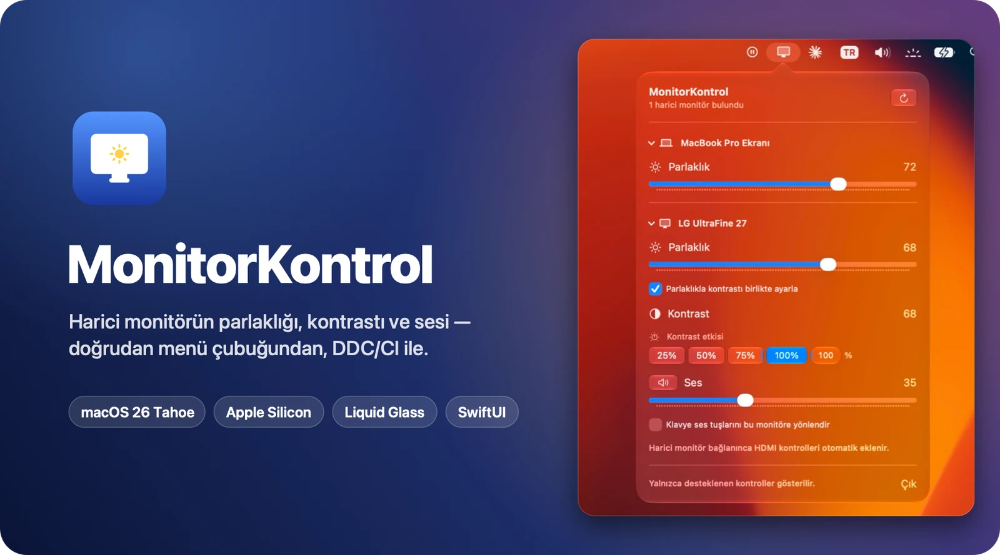
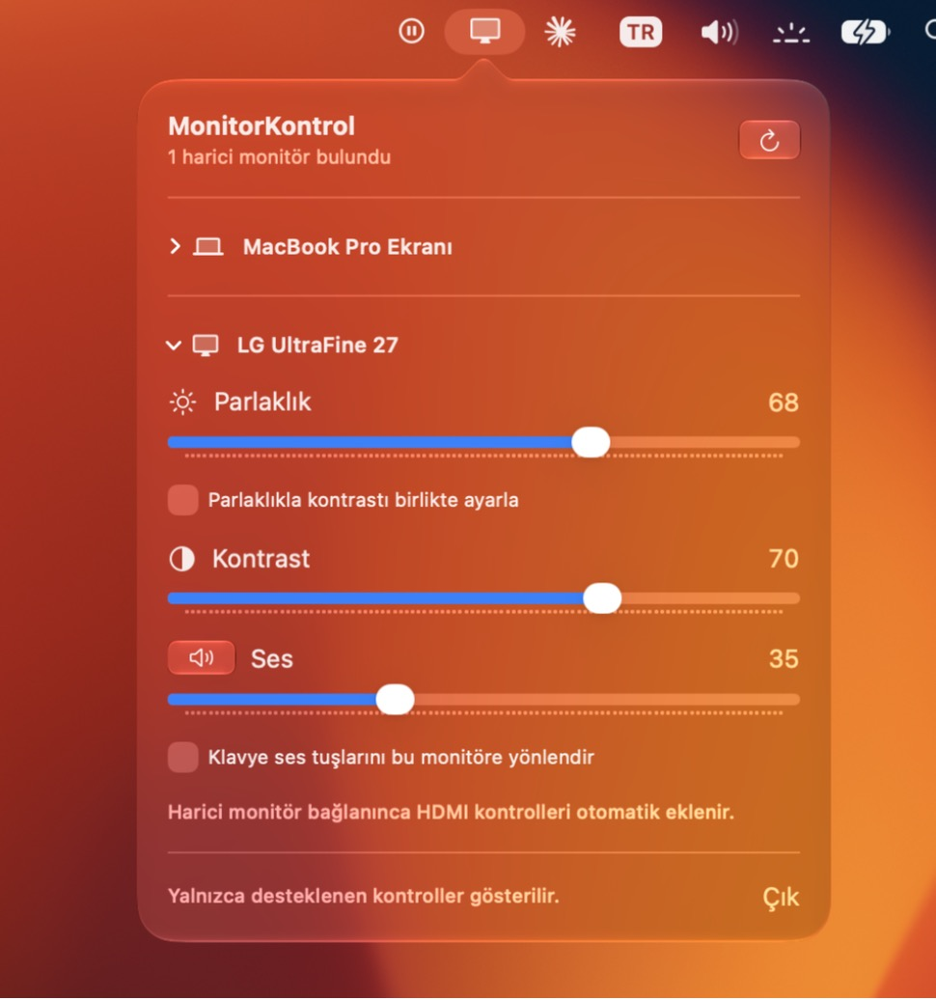
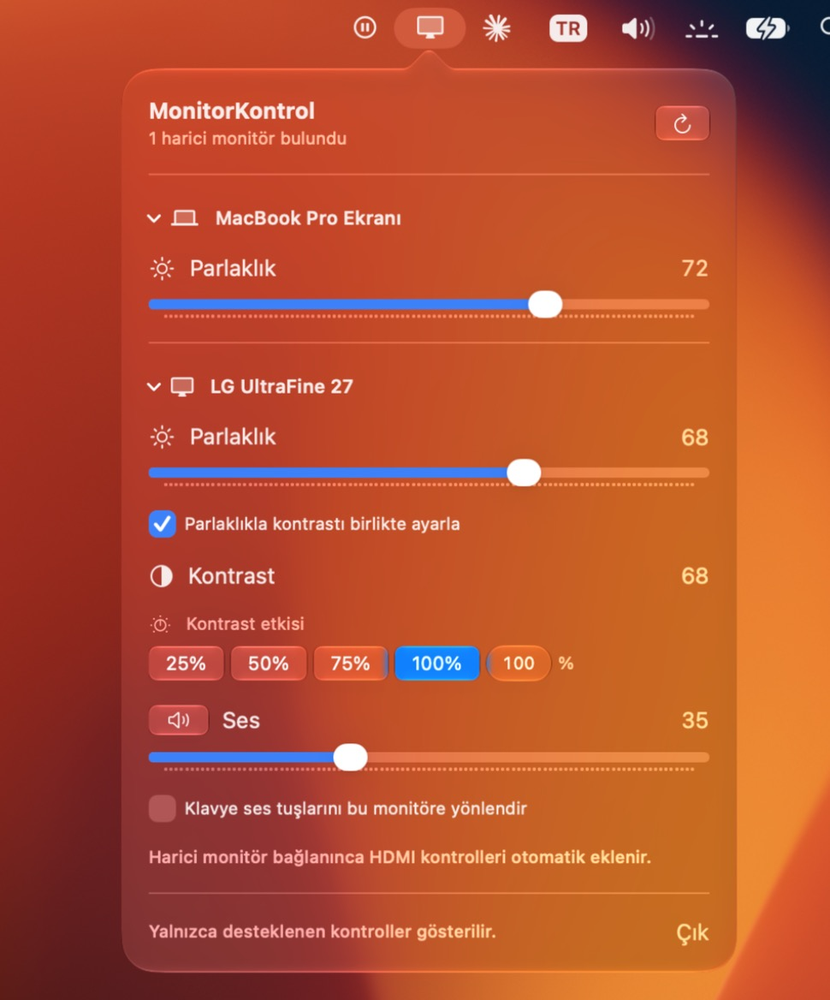
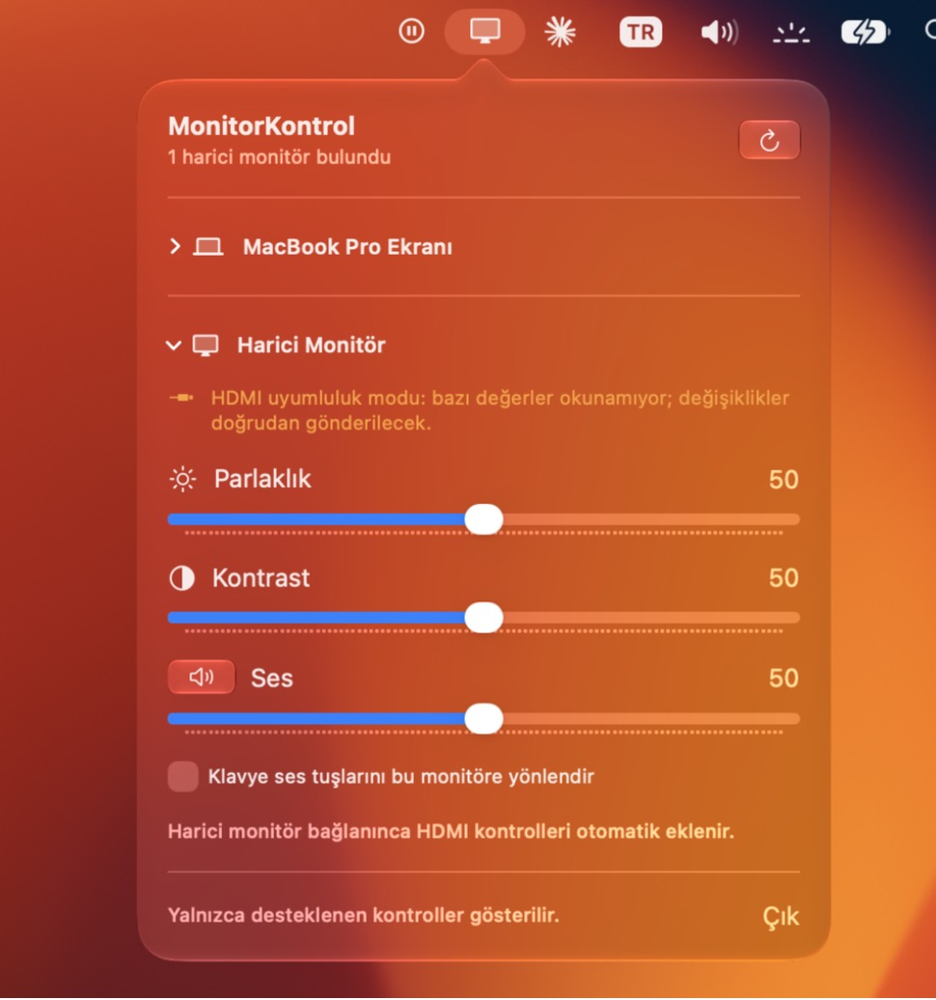
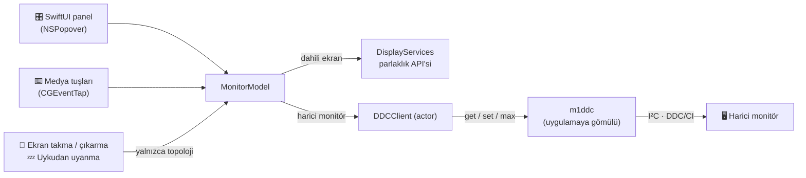
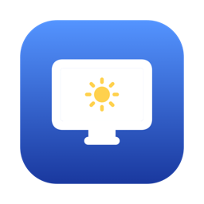

<div align="center">



<br>
<br>


**Apple Silicon Mac'ler için yerel, hafif ve Liquid Glass görünümlü bir menü çubuğu uygulaması.**
<br>
Dahili ekranın parlaklığını ve harici monitörlerin DDC/CI kontrollerini tek panelden yönetir.

[Özellikler](#-özellikler) •
[Ekran görüntüleri](#-ekran-görüntüleri) •
[Kurulum](#-kurulum) •
[Kullanım](#-kullanım) •
[Nasıl çalışır?](#-nasıl-çalışır) •
[Uyumluluk](#-donanım-ve-uyumluluk)

</div>

---

## ✨ Özellikler

<table>
<tr>
<td width="50%" valign="top">

### 🖥️ Tüm ekranlar tek panelde
Bağlı harici monitörleri otomatik bulur, birden fazla monitörü ayrı ayrı yönetir. MacBook'un dahili ekranını DDC monitörlerinden ayırır ve parlaklığını kendi ekran servisi üzerinden değiştirir.

</td>
<td width="50%" valign="top">

### 🎚️ Gerçek DDC değerleri
Parlaklık, kontrast, ses ve sessize alma kontrollerinden yalnızca monitörün desteklediklerini gösterir. Açılışta ve yenileme düğmesiyle monitörün **güncel** değerlerini okur.

</td>
</tr>
<tr>
<td width="50%" valign="top">

### 🔗 Parlaklık + kontrast bağlantısı
Parlaklığı değiştirdiğinde kontrastı seçtiğin oranda (`25%` · `50%` · `75%` · `100%` ya da elle) birlikte ayarlar. Gece/gündüz geçişlerinde tek sürgü yeter.

</td>
<td width="50%" valign="top">

### ⌨️ Klavye ses tuşları
Mac'in ses artırma, azaltma ve sessize alma tuşlarını seçtiğin monitöre yönlendirir. HDMI'da kilitli kalan macOS ses göstergesi yerine sesi doğrudan monitörde değiştirir.

</td>
</tr>
<tr>
<td width="50%" valign="top">

### 🔌 HDMI uyumluluk modu
Değerleri okunamayan bağlantılarda yazma odaklı moda geçer; kontroller görünür kalır ve sürgüyü bıraktığında değer monitöre gönderilir.

</td>
<td width="50%" valign="top">

### ⚡ Hafif ve sessiz
Monitör takma, çıkarma ve uykudan uyanmada listeyi kendiliğinden yeniler ama pahalı DDC okumalarını tekrarlamaz. Klasik `NSStatusItem` + animasyonsuz `NSPopover` ile Tahoe'da takılmadan açılır.

</td>
</tr>
</table>

> [!TIP]
> DDC motoru ([m1ddc](https://github.com/waydabber/m1ddc)) uygulamanın içine gömülüdür — Homebrew ya da ek paket kurmana gerek yok.

## 📸 Ekran görüntüleri

<table>
<tr>
<th width="33%">Kontrol paneli</th>
<th width="33%">Bağlı kontrast</th>
<th width="33%">HDMI uyumluluk modu</th>
</tr>
<tr>
<td></td>
<td></td>
<td></td>
</tr>
<tr>
<td valign="top"><sub>Harici monitör ilk bulunduğunda açık, dahili ekran bölümü kapalı gelir.</sub></td>
<td valign="top"><sub>Kontrast sürgüsü gizlenir; kontrast, parlaklığın seçilen oranını takip eder.</sub></td>
<td valign="top"><sub>Okunamayan değerler <code>50</code> güvenli başlangıç konumuyla gösterilir.</sub></td>
</tr>
</table>

## 🚀 Kurulum

### Gereksinimler

| | |
|---|---|
| 💻 **Mac** | Apple Silicon (M serisi) |
| 🍎 **Sistem** | macOS 26 (Tahoe) veya üzeri |
| 🛠️ **Derleme** | Xcode komut satırı araçları (`xcrun swiftc`, `make`) |
| 🖥️ **Monitör** | Menüsünden **DDC/CI** etkinleştirilmiş harici monitör |
| 🔌 **Bağlantı** | DDC komutlarını taşıyabilen port, adaptör ve kablo |

### Derleme

```sh
git clone https://github.com/emirguney/MonitorKontrol.git
cd MonitorKontrol
./build.sh
```

Betik gömülü `m1ddc` aracını ve Swift uygulamasını derler, uygulamayı ad-hoc imzalar ve şunları üretir:

```text
dist/
├── MonitorKontrol.app   ← çalıştırılabilir uygulama
└── MonitorKontrol.zip   ← paylaşılabilir paket
```

> [!NOTE]
> Uygulama ad-hoc imzalıdır. Zip başka bir Mac'e indirilip açılırsa Gatekeeper engelleyebilir; bu durumda **Sistem Ayarları › Gizlilik ve Güvenlik** altından **Yine de Aç**'ı seç.

## 🎛️ Kullanım

1. Harici monitörü Mac'e bağla.
2. Monitörün kendi menüsünden **DDC/CI** özelliğini aç.
3. `dist/MonitorKontrol.app` uygulamasını çalıştır.
4. Menü çubuğundaki <kbd>🖥</kbd> simgesine tıkla.
5. Monitörün bölümünü açıp parlaklık, kontrast veya sesi ayarla.

Sağ üstteki <kbd>↻</kbd> düğmesi ekranları yeniden tarar ve okunabilen gerçek DDC değerlerini tekrar yükler.

### 🔗 Parlaklık ve kontrastı birlikte ayarlama

Gerçek parlaklık ve kontrast değerleri okunabilen harici monitörlerde **Parlaklıkla kontrastı birlikte ayarla** seçeneği görünür.

- İsteğe bağlıdır; ilk açılışta kapalıdır. Açtığında kontrast etkisi `%100` ile başlar.
- **Kontrast etkisi**, parlaklıktaki değişimin kontrast aralığına ne kadar yansıyacağını belirler:

  ```text
  kontrast = (parlaklık / maks. parlaklık) × maks. kontrast × kontrast etkisi
  ```

  `%0` kontrastı sıfıra çeker, `%100` parlaklıkla birebir aynı oranı uygular.
- Önce parlaklık, ardından kontrast yazılır. Kontrast yazılamazsa parlaklığın uygulandığı arayüzde açıkça bildirilir.
- Değerlerin okunamadığı HDMI uyumluluk modunda bu seçenek gösterilmez.

### ⌨️ Klavye ses tuşlarını monitöre yönlendirme

Ses kontrolü olan harici monitörlerde **Klavye ses tuşlarını bu monitöre yönlendir** seçeneğini aç:

| Tuş | Etki |
|---|---|
| <kbd>🔊</kbd> | Monitör sesini 5 birim artırır |
| <kbd>🔉</kbd> | Monitör sesini 5 birim azaltır |
| <kbd>🔇</kbd> | Sesi kapatır; tekrar basınca son duyulabilir seviyeye döner |

> [!IMPORTANT]
> Medya tuşlarını yakalamak için **Erişilebilirlik** izni gerekir. İzin yoksa panelde doğrudan ilgili Sistem Ayarları sayfasını açan bir düğme çıkar. Seçim yeniden başlatmalarda hatırlanır; aynı anda tek monitör hedeflenebilir.

## 🧠 Nasıl çalışır?



- **Dahili ekran** hiçbir zaman DDC yolundan geçmez ve HDMI monitörü olarak sınıflandırılmaz.
- **Otomatik yenileme** (takma, çıkarma, uyanma) yalnızca bağlı ekran listesini günceller ve bilinen değerleri korur; HDMI el sıkışması gecikebildiği için 0,8 sn ve 3 sn sonra iki kez tarar.
- **Tam DDC okuması** yalnızca uygulama açılırken ve <kbd>↻</kbd> ile yapılır; böylece menü çubuğu gecikmesi oluşmaz.

## 🔧 Donanım ve uyumluluk

- Görüntünün HDMI'dan gelmesi, aynı yolun DDC/CI komutlarını da taşıdığını garanti etmez. Sonuç Mac modeline, bağlantı köprüsüne, adaptöre, kabloya ve monitöre göre değişir.
- `MacBookPro18,3` modelindeki dahili HDMI hattı için MCDP29xx DDC köprüsü ve köprüye özel `0xB7` adresi desteklenir; bu, tüm HDMI donanımları için genel bir garanti değildir.
- Bir DDC kontrolü okunamazsa uygulama yazma odaklı uyumluluk moduna geçer. Bu moddaki `50` değerleri monitörden okunmuş değil, güvenli başlangıç konumlarıdır.
- Monitör girişini değiştirme kontrolleri güncel sürümde yer almaz.

## 🧪 Geliştirme

Gerçek bir monitör bağlamadan arayüzü denemek için sahte bir DDC yardımcısıyla çalıştırabilirsin:

```sh
./build.sh
MONITORKONTROL_HELPER="$PWD/Tests/mock-m1ddc.sh" \
  ./dist/MonitorKontrol.app/Contents/MacOS/MonitorKontrol
```

`MONITORKONTROL_HELPER`, gömülü `m1ddc` yerine kullanılacak çalıştırılabilir dosyayı belirler. Bu README'deki ekran görüntüleri de bu yolla, sahte değerlerle alındı.

## 📄 Kaynak ve lisans

DDC taşıma katmanında MIT lisanslı [waydabber/m1ddc](https://github.com/waydabber/m1ddc) kullanılır. Lisans metni [`Vendor/m1ddc/LICENSE`](Vendor/m1ddc/LICENSE) içinde korunur ve derlenen uygulamanın kaynaklarına eklenir.

<div align="center">
<br>

<br>
<sub>macOS menü çubuğundan, monitörüne bir tık uzaklıkta.</sub>
</div>
